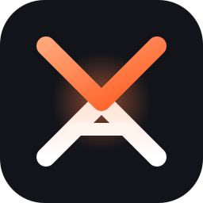
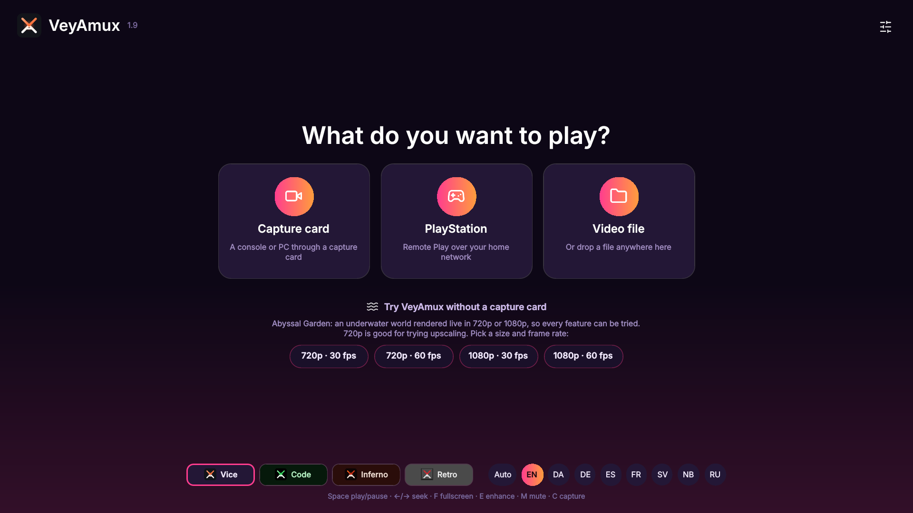
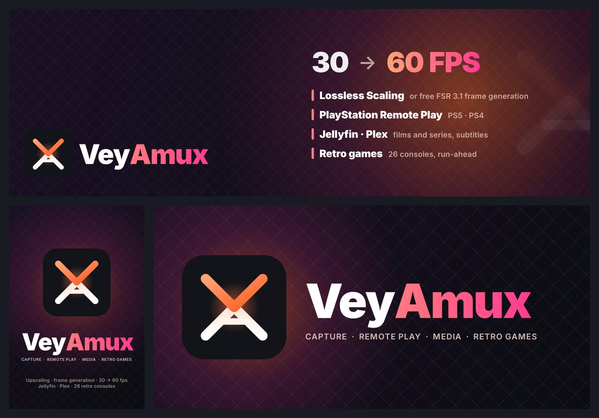
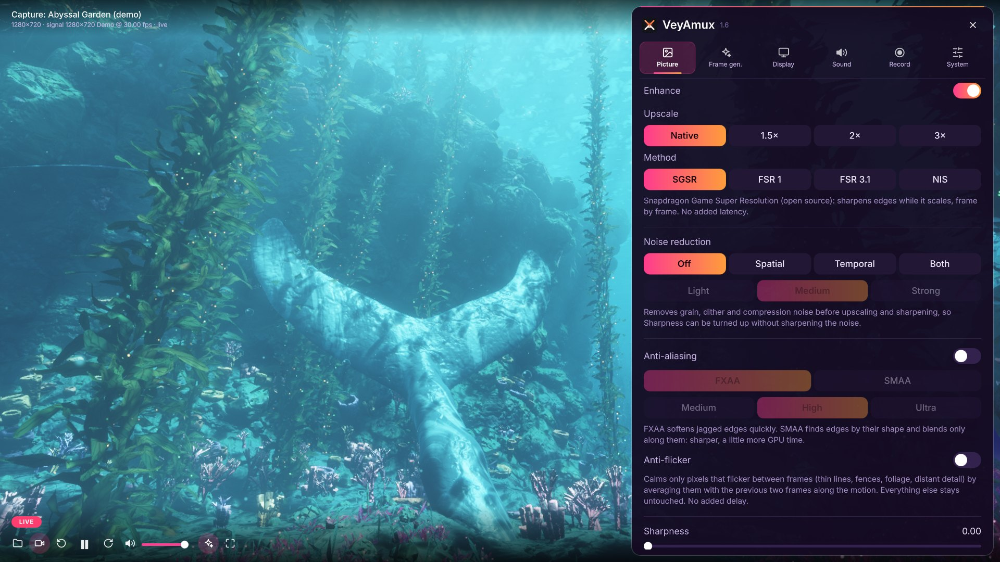
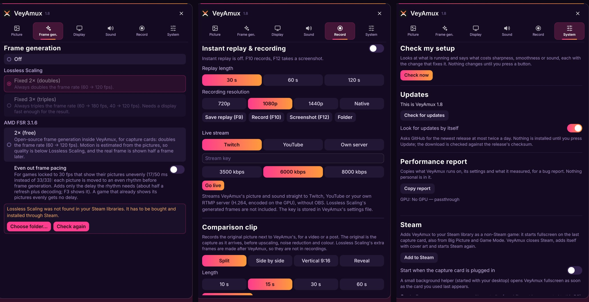
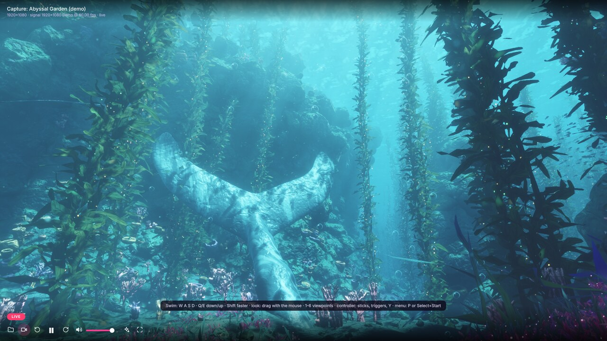
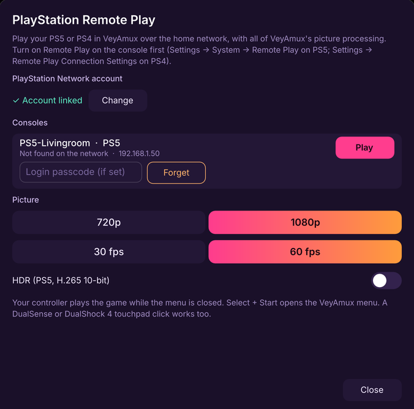
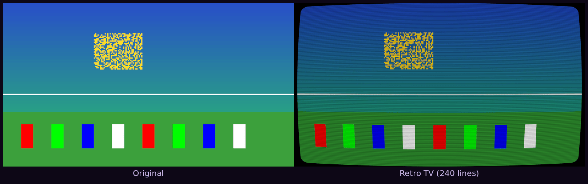
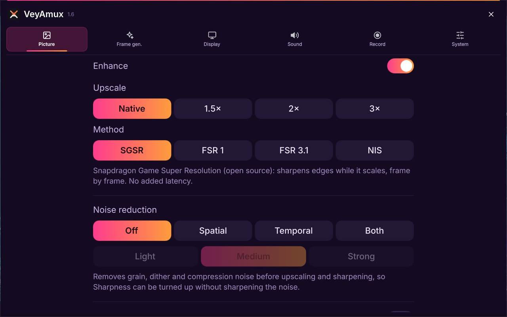

<p align="center">
  
</p>

<h1 align="center">VeyAmux</h1>

<p align="center">
  A <b>Linux</b> capture-card viewer and video player that enhances the picture on your graphics card,
  <br>shipped as a single <b>AppImage</b>.
</p>

<p align="center">
  Upscaling (SGSR · FSR&nbsp;1 · NIS · FSR&nbsp;3.1.6) · noise reduction · anti-flicker · FSR&nbsp;3.1.6 TAA · frame generation (Lossless Scaling or free FSR&nbsp;3.1.6) ·
  HDR · <b>PlayStation Remote Play</b> (PS5 / PS4) · Retro TV (CRT) and pixel-perfect scaling · replay, recording and
  live streaming · window or screen as a source · built-in 3D demo · controller support · Steam Deck · one-click Steam
  shortcut with artwork · 8 languages
  <br>
  <a href="https://github.com/8BiTw0LF/VeyAmux/releases/latest"><b>Download the latest release</b></a> ·
  GPL-3.0 (the program: AGPL-3.0, see below) · Linux port of <a href="https://github.com/Likely7/Veyra-NRVideo">Veyra-NRVideo 2.1.5</a>
</p>

<p align="center">
  
</p>

---

## New in 1.7

- **PlayStation Remote Play by IP address:** if the console is not found, type its IP address. VeyAmux asks it
  directly, which also works across subnets, VPNs and firewalls (such as Bazzite's) that drop the answer to the
  network-wide search, and the console can be registered even if it never answers the search.

## New in 1.6

- **A new start screen and menu:** the sources as three large cards, and a menu with six tabs (Picture, Frame
  generation, Display, Sound, Record, System). It grows with the screen, so it reads well from the couch, and LB / RB
  switch tabs on a controller.
- **Updates from inside VeyAmux:** it looks for a new version on GitHub by itself (at most twice a day). One click
  downloads it, checks it against the release's checksum and puts it in place; Gear Lever is no longer needed.
- **Smoother frame generation:** repeated frames are now found by comparing the whole picture, so a small movement
  seen from a still camera is no longer thrown away as a repeat. VeyAmux also warns when frame generation asks for
  more frames than the screen can show, and when the capture card sends compressed MJPEG while it has an
  uncompressed mode.
- **Picture:** SMAA anti-aliasing, and texture, clarity and dehaze.
- **Comparison clips:** the original picture next to VeyAmux's (split, side by side, vertical 9:16 or a sweeping
  reveal), and clip markers (**F6**) while recording.
- **Check my setup:** finds what costs sharpness, smoothness or sound, each with a button that fixes it, and a
  performance report to copy into bug reports.

Several of these come from [PushFPS](https://github.com/DosukaSOL/PushFPS) 4.1 (GPL-3.0). New in 1.5: frame pacing
repair, sharp fit-to-window scaling, HUD lock and the VRR warning. New in 1.4: SGSR upscaling and Abyssal Garden in
720p. [All release notes](https://github.com/8BiTw0LF/VeyAmux/releases)

<p align="center">
  
  <br><sub>The artwork VeyAmux adds to your Steam library: background with logo, cover and wide cover.</sub>
</p>

## What is VeyAmux?

VeyAmux shows the picture from a **capture card** (a PlayStation, Xbox, Switch or another PC), straight from a
**PS5 or PS4 over your home network** (PlayStation Remote Play, no capture card needed), from a **window or a whole
screen** on your desktop, or from a **video file**, and makes it look better on your graphics card. It can:

- **upscale and sharpen** the picture with AMD FSR 1, NVIDIA Image Scaling (NIS), AMD FSR 3.1.6 or Snapdragon Game Super Resolution (SGSR);
- **remove noise**, grain and compression blocks, **calm flickering** detail, and smooth edges with FXAA, SMAA or FSR 3.1.6 TAA;
- **double or triple the frame rate** with Lossless Scaling, or double it for free with AMD FSR 3.1.6 frame generation (switch between them in the menu);
- **handle HDR**: tone-map HDR games for an SDR screen, or send real HDR to an HDR screen;
- **look like an old TV** with *Retro TV* (curved CRT glass, scanlines and phosphor stripes), or show retro games with
  **pixel-perfect** sharp, square pixels;
- **record, keep an instant replay and stream** to Twitch or YouTube, all encoded on the graphics card.

No capture card yet? The **built-in demo** renders a live 3D underwater world, so you can try all of it right away. The
menu can also be steered with a **game controller**, and on the **Steam Deck** and other handhelds it fills the screen
and works with touch.

It runs on most distributions without installing anything, and it is built for **low latency**. A captured frame is
uploaded to the GPU once, and everything else happens there. VeyAmux needs well under 1 ms of CPU time per 4K frame.

Developed and tested on **Bazzite** (KDE Plasma) with an **AMD RX 9070 XT** and an **AVerMedia Live Gamer Ultra 2.1**.

<p align="center">
  
  <br><sub>The built-in demo with the menu (P) open on the Picture tab.</sub>
</p>

<p align="center">
  
  <br><sub>The Frame generation, Record and System tabs. The findings under <i>Check my setup</i> are from a test PC without a graphics card.</sub>
</p>

## What do I need?

Only the AppImage and a graphics card with Vulkan (any recent AMD, Intel or NVIDIA driver). **Lossless Scaling is only
needed for its own frame generation**, and everything else works without it:

| Feature | VeyAmux alone | + Lossless Scaling and lsfg-vk |
|---|:---:|:---:|
| Capture cards, video files, windows and screens | ✅ | ✅ |
| PlayStation Remote Play (PS5 / PS4 on the home network) | ✅ | ✅ |
| Upscaling: SGSR, FSR 1, NIS, FSR 3.1.6 | ✅ | ✅ |
| Noise reduction, anti-flicker, sharpness, anti-aliasing (FXAA, FSR 3.1.6 TAA), colour | ✅ | ✅ |
| HDR capture, HDR video files, HDR output, VRR mode | ✅ | ✅ |
| Retro TV (CRT-Geom), pixel-perfect scaling | ✅ | ✅ |
| Built-in demo scene, controller in the menu | ✅ | ✅ |
| Instant replay, recording, screenshots, live streaming, OBS | ✅ | ✅ |
| Sound output choice, sound meter, audio delay, profiles | ✅ | ✅ |
| **Frame generation 2×**: AMD FSR 3.1.6 (free, inside VeyAmux) | ✅ | ✅ |
| **Frame generation 2× / 3×**: Lossless Scaling (best quality) | – | ✅ |

> Lossless Scaling is a paid application on Steam (by THS). lsfg-vk (CC BY-NC-ND 4.0) is a separate open-source project
> that runs its frame generation on Linux. Neither is included: VeyAmux finds and uses **your own** installation. If only
> an older lsfg-vk 1.x is installed, VeyAmux downloads lsfg-vk 2 from its official site and installs it for you.

## Features

### Sources
- **Built-in demo (no capture card needed)**: *720p* or *1080p* at *30* or *60 fps* on the start screen starts
  **Abyssal Garden**, an underwater world with kelp forests, light shafts, a shipwreck and manta rays. It is rendered live
  in 720p or 1080p on your graphics card and goes through VeyAmux exactly like a console's picture. So upscaling, noise
  reduction, Retro TV, frame generation, recording and streaming can all be tried on a moving 3D scene.
  - **Swim:** **W A S D**, **Q / E** down / up, **Shift** faster.
  - **Look around:** drag with the mouse.
  - **Viewpoints:** **1–6**.
  - **Controller:** sticks to swim and look, triggers for down / up, **Y** for the next viewpoint.
  - **Menu:** **P** or **Select + Start** opens it, and the game stops while it is open.

  The first start builds the world, which takes a few seconds.

  <p align="center">
    
  </p>
- **PlayStation Remote Play** (PS5 and PS4, over your home network, no capture card): press **PlayStation** on the
  start screen (or *PlayStation Remote Play* in the capture window).
  - **Once:** log in to PlayStation Network. VeyAmux opens Sony's login page in your browser; afterwards you paste the
    address the browser ends on, and VeyAmux reads your account ID from it.
  - **Once per console:** on the console open *Settings → System → Remote Play → Link Device* (PS5) or *Settings →
    Remote Play Connection Settings → Add Device* (PS4), and type the 8-digit number into VeyAmux.
  - **Console not found?** Type its IP address under *Add a console by IP address* (shown on the console under
    *Settings → Network → Connection Status*). VeyAmux then asks it directly, which also works across subnets, VPNs and
    firewalls that drop the answer to the network-wide search, and it can be registered even if it never answers the
    search.
  - **Then:** press **Play**. A console in rest mode is woken up. The picture (720p or 1080p, 30 or 60 fps, HDR on the
    PS5) and the sound come straight into VeyAmux, with all its processing.
  - **Controller:** your controller plays the game while the menu is closed (any controller; a DualSense or DualShock 4
    touchpad click counts as the touchpad button). **Select + Start** still opens the VeyAmux menu. Rumble from the
    game reaches the controller.
  - **Delay:** the frame-time overlay (**F3**) shows the network, decoding and VeyAmux delay, their total, the bitrate
    and the packet loss. The console's own encoding (about 5–10 ms) cannot be measured.
  <p align="center">
    
    <br><sub>The Remote Play window (example console).</sub>
  </p>
  - Built on the protocol library of [chiaki-ng](https://github.com/streetpea/chiaki-ng). Only on the local network for
    now (not over the internet).
- **Capture cards** (V4L2 / UVC): every mode the card offers (NV12, YUYV, UYVY, P010 HDR, I420, RGB, MJPEG), the best
  one marked with ★. If you pick a compressed MJPEG mode where the card also has an uncompressed one, VeyAmux says so. If the card drops out, or stalls when the console changes resolution, refresh rate or HDR,
  VeyAmux reconnects by itself.
- **A window or a whole screen** (Wayland: KDE Plasma, GNOME, …): choose *Window or screen …* under **Capture**, and your
  desktop asks what to share, the same way OBS and Discord do. The picture gets all of VeyAmux's processing.
- **Video files** through FFmpeg, with hardware decoding (VA-API) on AMD and Intel.
- **What the game really runs at**: the info line shows the measured frame rate and an estimate of the game's own
  rendering resolution, not just the signal. Example: `≈1920×1080 @ 30 fps → 60 fps (Lossless Scaling 2×) · signal 3840×2160 NV12 @ 60 fps`.

### Picture
- **Upscaling** 1.5× / 2× / 3×:
  - **SGSR** (default): Qualcomm's Snapdragon Game Super Resolution, edge-adaptive upscaling frame by frame, no
    added latency.
  - **AMD FSR 1**: edge-aware upscaling with sharpening, frame by frame, no added latency.
  - **NVIDIA Image Scaling (NIS)**: directional scaling with adaptive sharpening, on any GPU.
  - **AMD FSR 3.1.6**: temporal upscaling, fed by VeyAmux's own motion estimation. At **Native** it works as
    temporal anti-aliasing (TAA, AMD's "Native AA"): it calms flickering and crawling edges without enlarging the
    picture. Games that already use TAA mostly get softer.
- **Noise reduction**: *Spatial*, *Temporal* (motion-compensated) or *Both*, in three strengths. It removes grain,
  dithering and compression noise, so *Sharpness* can be raised without sharpening the noise.
- **Anti-flicker**: calms only the pixels that flicker between frames (thin lines, fences, foliage, distant detail) by
  averaging them with the two previous frames along the motion. Everything else is left alone, and it adds no delay.
- **Sharpness**, **anti-aliasing** (FXAA or SMAA), **exposure**, **contrast** and **saturation**.
- **Texture, clarity and dehaze** (from Veyra): texture brings out fine detail, clarity the contrast of mid-sized
  shapes, and dehaze takes away a grey veil. The colours stay as they are.
- **Retro TV**: turns the picture into an old CRT television, with a slightly curved glass screen, rounded corners,
  visible scanlines and red-green-blue phosphor stripes. This is CRT-Geom with the same settings as ShaderGlass'
  `crt-geom` preset. Choose 240 lines (old consoles), 480 lines (PS2 / GameCube era) or the source's own lines.
- **Pixel-perfect scaling** (under Retro TV): the picture is enlarged by a whole number with sharp, square pixels, the
  way emulators do it, instead of being stretched soft. With *Game pixels* (*Auto*, 240p or 480p) VeyAmux first finds the
  retro game's own pixel grid inside the capture signal (a 320×240 game in a 1080p signal), so every game pixel becomes
  an exact, even block on screen.

<p align="center">
  
</p>

### Frame generation
- **Lossless Scaling** *Fixed 2×* and *Fixed 3×* through lsfg-vk, for VeyAmux's window only. VeyAmux finds Lossless
  Scaling in all Steam libraries (Flatpak included), writes its own lsfg-vk profile and leaves your other lsfg-vk
  settings alone. It has a *performance mode* and an automatic flow scale. If VRR (Adaptive Sync) is on in KDE,
  VeyAmux warns you: lsfg-vk 2 needs a fixed refresh to space its frames evenly.
- **AMD FSR 3.1.6 2× (free)**: frame generation inside VeyAmux (open source, any GPU, capture cards). It sits next to
  the Lossless Scaling modes, so you can switch between them. The motion is estimated from the pictures, so the quality is below Lossless Scaling, and the real
  frame is shown half a frame later. *Lock the HUD* keeps still text, maps and gauges from warping in the generated
  frames.
- **Smarter input**: a 30 fps game in a 60 Hz signal repeats every picture. VeyAmux drops the repeats, so frame
  generation turns 30 distinct frames into smooth 60. Every pixel of the picture is compared, so even a small movement
  seen from a still camera counts as a new frame and is not thrown away.
- **Screen check**: if frame generation asks for more frames than the screen shows (30 fps × 3 on a 60 Hz screen),
  VeyAmux says so and what to change.
- **Even out frame pacing** (optional): many games locked to 30 fps show their pictures 17/50 ms apart instead of 33/33,
  and frame generation keeps that judder. VeyAmux moves each picture to an even rhythm first (costs one refresh of delay,
  about 17 ms at 60 Hz).
- **120 Hz rule**: when the capture runs at about 120 fps, AMD FSR frame generation pauses (doubling would only add
  latency) and resumes below 80 fps.
- **VRR mode**: with frame generation off, VeyAmux shows the game's own frames at an even pace (e.g. 45 fps), so a VRR
  display can follow the game.

### Sharp in any window size
The finished picture is resampled to exactly the pixels it covers in the window (Catmull-Rom, wider when shrinking), so
it is drawn 1:1 instead of being stretched bilinearly: sharper when enlarged, no crawling lines when shrunk.

### HDR
- **HDR capture (P010)** and **HDR video files** (HDR10 / PQ and HLG) are tone-mapped properly for an SDR screen (BT.2390,
  Veyra's own HDR functions) instead of looking washed out. You set the source's peak brightness to match the game's
  HDR calibration.
- **HDR output** (experimental): on an HDR desktop (KDE Plasma 6, GNOME 48 or newer), VeyAmux sends real HDR10 or scRGB
  to the screen, with the full BT.2020 colours and highlights up to the screen's peak brightness, which it reads
  automatically from the screen (EDID). Recordings, screenshots and OBS still get normal SDR.

### Sound
- **Sound output**: pick any output (TV, headset, speakers, virtual surround). It switches while playing.
- **Sound from the source**: a live spectrum shows whether sound is coming in from the card or file at all.
- **Mute for you, not for your viewers**: mute (**M**) and the volume only affect your speakers. Recordings, replays and
  the live stream always get the sound.
- **Even out loudness**, **audio delay** (−300 … +300 ms, to match the processed picture), and low-latency pass-through
  of the capture card's sound (5 ms blocks).

### Record, replay and stream
- **Instant replay** keeps the last 30, 60 or 120 seconds. **F9** saves them, **F10** records, and **F12** takes a
  screenshot.
- **Live streaming** to **Twitch**, **YouTube** or your own RTMP server at 3500, 6000 or 8000 kbps, without OBS. The
  replay and recordings keep running at the same time.
- Everything is the finished, enhanced picture with the sound, encoded on the graphics card (VA-API HEVC / H.264), so
  the display does not slow down.
- **OBS browser source**: VeyAmux can also hand its finished picture to OBS.

### Everyday use
- **Profiles**: save the picture settings under a name and switch with **1–9**. Bind a profile to a capture signal, and
  it is applied automatically.
- **Frame-time overlay** (**F3**): a graph with fps, 1 % low, jitter and the delay inside VeyAmux.
- **Add to Steam**: VeyAmux becomes a non-Steam game that starts fullscreen on the last source, also from Big Picture
  and Bazzite's Game Mode. VeyAmux closes Steam by itself, adds the shortcut with cover art, a background and a logo
  for the library, and starts Steam again.
- **Start when the capture card is plugged in**: a small background helper opens VeyAmux fullscreen as soon as the card
  appears.
- **Game controller in the menu**: hold **Select + Start** (or the **Guide / PS** button for half a second) to open and
  close the menu. While it is open, the controller only steers the menu (the game gets nothing): the D-pad or left
  stick moves, **A** chooses, left/right change a slider, **LB / RB** switch between the tabs and **B** closes. Xbox,
  PlayStation, Switch and most other controllers work.
- **Steam Deck and touchscreens**: on the Deck, Select + Start are the **View (⧉)** and **Menu (☰)** buttons. The menu
  can also be opened without them: a tap on the touchscreen shows the controls with the menu button (a tap does not
  pause), and the right touchpad works as a mouse. On handhelds (Steam Deck, ROG Ally, Legion Go and other screens
  under about 10") and in small windows the menu fills the whole window at a readable size and scrolls; **✕** in the
  corner closes it.

  <p align="center">
    
    <br><sub>The menu on a 1280×800 handheld screen (Steam Deck size).</sub>
  </p>
- **Updates from inside the app**: VeyAmux looks for a new version on GitHub (at most twice a day, or when you ask).
  One click downloads it, checks it against the release's checksum and puts it in place of the AppImage; it starts at
  the next restart. Gear Lever and AppImageUpdate still work too.
- **Check my setup** (System tab): looks at what is running and says what costs sharpness, smoothness or sound, each
  with one button that fixes it. A **performance report** can be copied for bug reports.
- **Four themes**, chosen on the start screen, and the logo changes with them:
  - **Vice**: violet with a pink-to-orange sunset gradient.
  - **Code**: black with terminal green and monospace text.
  - **Inferno**: near-black with blood red, ember orange and classical capitals.
  - **Retro**: 8-bit console greys and red, square buttons with a hard edge, and a pixel font.
- **Eight languages**: English, Danish, German, Spanish, French, Swedish, Norwegian (Bokmål) and Russian, chosen from
  the system or on the start screen.
- **The menu** has six tabs: Picture, Frame generation, Display, Sound, Record and System.

## Latency

Measured on an AMD RX 9070 XT with a 3840×2160 NV12 capture, noise reduction (*Both*) and FSR 1, VeyAmux needs:
- **under 1 ms of CPU work** per frame,
- **about 7 ms of GPU work** per frame.

The menu shows *Delay in VeyAmux*, the time from the capture driver's timestamp until the picture is finished. In that
setup it reads about 29–32 ms, and most of it is the picture waiting for the next display refresh, not processing.
Lighter settings lower it. The capture card, USB, Lossless Scaling and the display add their own latency on top, as
with any capture setup.

## Installation

### 1. VeyAmux

Download `VeyAmux-x86_64.AppImage` from **[Releases](https://github.com/8BiTw0LF/VeyAmux/releases/latest)**, make it
executable and start it:

```sh
chmod +x VeyAmux-x86_64.AppImage
./VeyAmux-x86_64.AppImage
```

VeyAmux updates itself: when a new version is out, it offers it on the start screen and under *System*. You can
also install it with **[Gear Lever](https://flathub.org/apps/it.mijorus.gearlever)**.

The AppImage contains everything it needs (Qt, FFmpeg, shaders), and nothing is installed on the system. If FUSE is
missing, use `APPIMAGE_EXTRACT_AND_RUN=1 ./VeyAmux-x86_64.AppImage`.

Press **C** (or **Capture**) to choose a capture card, window or screen. Press **P** (or ✨) for the menu.

### 2. Lossless Scaling (only for its frame generation)

1. Buy and install **[Lossless Scaling](https://store.steampowered.com/app/993090/Lossless_Scaling/)** on Steam. You
   do not need to start it.
2. Choose the **lsfg-vk** branch: Steam → *Library* → right-click *Lossless Scaling* → *Properties* → *Betas* →
   **lsfg-vk**, and let Steam update. (lsfg-vk 2 needs `lsfg-vk.dll` from that branch. The default branch only has
   `Lossless.dll`, and VeyAmux will tell you so.)

### 3. lsfg-vk 2 (only for Lossless Scaling)

The official guide is at **[lsfg-vk.dev](https://lsfg-vk.dev/docs/installation/)**.

**Automatic:** if VeyAmux finds an older lsfg-vk (1.x), it downloads the official lsfg-vk 2 build from
builds.lsfg-vk.dev and unpacks it into `~/.local` (checked against a known SHA-256). The old lsfg-vk 1 files in your
home folder are moved to `~/.local/share/VeyAmux/lsfg-vk-1-backup/`. The menu also has an **Install lsfg-vk 2** button.
An lsfg-vk 1 installed as a system package must be removed with the package manager first. To turn the automatic
install off: `VEYAMUX_LSFG_AUTOINSTALL=0`.

**By hand on Bazzite, SteamOS, Fedora Atomic and others without a package** (installs into your home folder):

```sh
# download the latest .tar.xz from https://builds.lsfg-vk.dev, then:
tar -xvf lsfg-vk-*.tar.xz -C ~/.local
~/.local/bin/lsfg-vk-cli healthcheck
```

**Arch Linux** (AUR): `yay -S lsfg-vk`

You don't need lsfg-vk's own UI or profiles. VeyAmux writes its own profile (`~/.config/VeyAmux/lsfg-vk.toml`). Remove
an old lsfg-vk 1.x first.

### 4. Turn on frame generation

Open the menu (**P**). Under *Frame generation*, choose **Fixed 2×** (Lossless Scaling) or **2× (free)** under *AMD FSR 3.1.6*. If
the menu shows *Restart now*, press it. With Lossless Scaling, the status box should say **"Active through lsfg-vk"**.

**Refresh rate:** lsfg-vk has no frame pacing, so set the display to the result. 60 fps × 2 = 120 fps needs a 120 Hz
display. Turn VRR / adaptive sync off for VeyAmux.

## Troubleshooting

| Problem | Solution |
|---|---|
| Lossless Scaling was not found | Install it through Steam (step 2). If it is somewhere unusual, use *Choose folder…* in the menu. |
| "Only Lossless.dll was found" | Choose the **lsfg-vk** branch in Steam (step 2). |
| "lsfg-vk is not installed" or an old 1.x | Press *Install lsfg-vk 2* in the menu, or install it by hand (step 3) and run `lsfg-vk-cli healthcheck`. |
| Frame generation turned off after a crash | Press *Try again* in the menu. To start without lsfg-vk: `VEYAMUX_LSFG=0 ./VeyAmux-x86_64.AppImage` |
| Motion does not look smoother | The display's refresh rate must match (see step 4). Log: `~/.config/VeyAmux/lsfg-vk.log` |
| Lossless Scaling stutters or the picture seems to come and go | Turn VRR off (KDE: *Display & Monitor → Adaptive sync: Never*); VeyAmux warns when it is on. With a game locked to 30 fps, also turn on *Even out frame pacing*. |
| "Device or resource busy" | Another program (or a hung VeyAmux) uses the capture card. VeyAmux retries for 5 seconds and shows which program holds it. |
| No 4K @ 60 HDR mode | Many cards only send HDR (P010) at 4K30 or 1440p60 over USB. Use 4K60 NV12 (SDR), 1440p60 P010 with upscaling, or 4K30 P010 with frame generation. |
| HDR games look washed out | Choose a **P010 (HDR)** mode under Capture (C), and set *HDR capture: source peak brightness* to the game's HDR calibration. |
| HDR output says "no HDR swapchain" | Turn on HDR for the display (KDE: *Display & Monitor → High Dynamic Range*) and restart VeyAmux. On Bazzite, also set `ENABLE_HDR_WSI=1`. |
| *Window or screen* is missing or does nothing | It needs a Wayland desktop with xdg-desktop-portal and PipeWire (standard on KDE Plasma and GNOME). |
| "Sound from the source" says *No sound* | Choose the capture card's audio under Capture (C). With a window or screen, the program plays its own sound. |
| Stutter in games below 60 fps (no frame generation) | *Frame generation → Off → VRR* (restart), turn on *Adaptive sync* in the display settings, and run fullscreen. |
| Recording says "no usable video encoder" | VA-API needs the Mesa VA driver (`vainfo` should list HEVC / H.264 *EncSlice*). Bazzite has it. |
| Lossless Scaling's extra frames are missing in OBS | The browser source gets the picture *before* lsfg-vk. Capture the VeyAmux window with OBS's *Screen Capture (PipeWire)* instead. |

## Keyboard shortcuts

**Space** play/pause · **←/→** ±5 s (Shift ±30 s) · **↑/↓** volume · **F** fullscreen · **E** enhancement on/off ·
**P** menu · **M** mute (your speakers only) · **O** open file · **C** capture · **F3** frame-time overlay ·
**1–9** profiles · **F6** clip marker · **F9** save replay · **F10** record · **F12** screenshot

**Controller:** **Select + Start** (or hold **Guide**) menu · **D-pad / stick** move · **A** choose · **B** close ·
**LB / RB** menu tabs

**Demo:** **W A S D** swim · **Q / E** down / up · **Shift** faster · drag with the mouse to look · **1–6** viewpoints ·
controller sticks, triggers and **Y**

## Command line

| Option | What it does |
|---|---|
| `--capture /dev/video0` | Start on that capture card. |
| `--capture last` | Start on the last source (the card, even under a new `/dev/videoN`, or the last shared window). |
| `--capture screencast` | Open the desktop's share dialog for a window or screen. |
| `--capture demo:60` | Start the built-in demo (`demo:30` for 30 fps, `demo:60:720` for 720p). |
| `--fullscreen` | Start fullscreen. |
| `--panel` / `--dialog` | Start with the menu or the Capture dialog open. |
| `--reset-ui` | Test the graphics path again (after a driver or desktop change). |

Environment variables and technical details (in Danish): [docs/TEKNISK.md](docs/TEKNISK.md).

## About the Linux port

VeyAmux is a standalone Linux version (Vulkan, Qt 6 / QML, FFmpeg) of Veyra-NRVideo by Likely7 (Windows, D3D12 / C#).
Veyra's original HLSL shaders are reused, compiled to SPIR-V. Built for Linux:
- **Capture:** the low-latency capture path (V4L2 straight into the UI's Vulkan frame, with format conversion on the
  GPU), the content measurement (real frame rate and rendering resolution), and the window and screen source (portal
  and PipeWire).
- **Processing:** FSR 1, NIS and FSR 3.1.6 upscaling with VeyAmux's own motion estimation, noise reduction, FSR 3.1.6 frame
  generation, HDR output and Retro TV.
- **Output:** recording, replay and streaming, and the Lossless Scaling integration.

Not possible on Linux: FSR 4 (closed Windows DLLs only), DLSS and other NVIDIA-only features, and Veyra's "AMD NR" (it
runs NVIDIA's DLSS network through Windows HIP).

## Building from source

```sh
sudo apt install cmake ninja-build g++ pkg-config patchelf file python3 glslang-tools qt6-base-dev qt6-declarative-dev \
  qt6-svg-dev qt6-wayland libvulkan-dev libavformat-dev libavcodec-dev libavutil-dev libswscale-dev libswresample-dev \
  libpulse-dev libva-dev libpipewire-0.3-dev qml6-module-qtquick qml6-module-qtquick-window qml6-module-qtquick-layouts \
  qml6-module-qtqml-workerscript qt6-shader-baker zsync
./scripts/build-appimage.sh          # -> dist/VeyAmux-x86_64.AppImage
```

`scripts/fetch-tools.sh` downloads DXC (HLSL → SPIR-V), wgpu-native (for the demo), linuxdeploy and appimagetool
(Ubuntu 24.04 package names above).

## License and credits

- VeyAmux is licensed under **GPL-3.0**, like [Veyra-NRVideo](https://github.com/Likely7/Veyra-NRVideo) by Likely7,
  which it is built on (shaders and processing design). Because the program includes chiaki-ng's library
  (AGPL-3.0), the VeyAmux program as distributed is covered by the **AGPL-3.0**.
- **PlayStation Remote Play:** [chiaki-ng](https://github.com/streetpea/chiaki-ng) v1.10.1 protocol library (AGPL-3.0
  with OpenSSL exception), with nanopb (zlib) and jerasure / gf-complete (BSD).
- **Third-party code:**
  - AMD FidelityFX SDK 1.1.4 + FSR 3.1.6 effect code from SDK 2.4.0 (MIT)
  - NVIDIA Image Scaling SDK (MIT)
  - CRT-Geom by cgwg, Themaister and DOLLS (GPL-2.0+), as used in [ShaderGlass](https://github.com/mausimus/ShaderGlass)
  - Qt 6 and FFmpeg (LGPL)
  - PipeWire headers (MIT)
  - Press Start 2P and Cinzel fonts (SIL OFL 1.1)
  - SPIRV-Reflect (Apache-2.0)
  - [Abyssal Garden](https://github.com/Noniv/abyssal-garden) by Maksymilian Dendura (MIT): the demo scene, ported from
    JavaScript to C++
  - [wgpu-native](https://github.com/gfx-rs/wgpu-native) (MIT / Apache-2.0)

  See [THIRD_PARTY_NOTICES_LINUX.md](THIRD_PARTY_NOTICES_LINUX.md).
- [lsfg-vk](https://lsfg-vk.dev) and [Lossless Scaling](https://store.steampowered.com/app/993090/Lossless_Scaling/) are
  **not** part of VeyAmux. No code, shaders or DLLs from them are copied or distributed.
